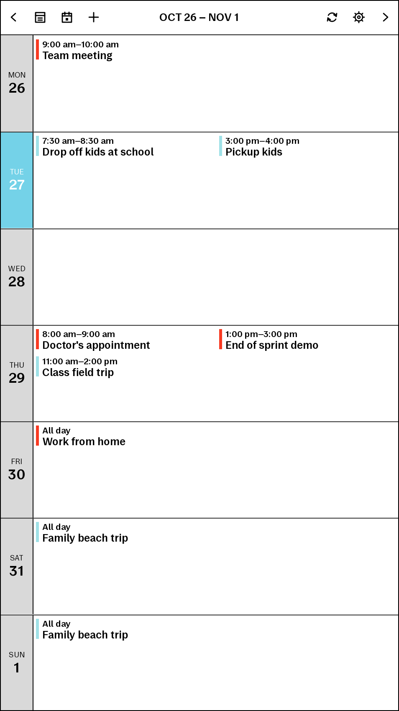
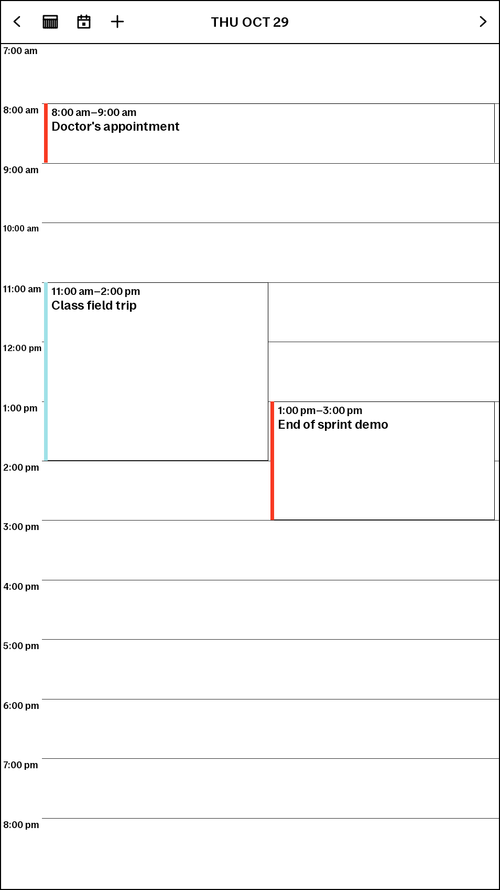

# reMarkable Calendar

_A native Google Calendar app for your reMarkable tablet._

| Week View                                                    | Day View                                                    |
| ------------------------------------------------------------ | ----------------------------------------------------------- |
|  |  |

See your week, browse a day's schedule, and create or edit events on your tablet. Sync over Wi-Fi, then keep using your saved calendar offline. Offline changes are sent to Google the next time you sync.

The app appears as **Calendar** in AppLoad. It was designed for **reMarkable Paper Pro Move**, however it also runs and works well on the full size Paper Pro.

## Features

| Status | Feature                      | Description                                                        |
| :----: | ---------------------------- | ------------------------------------------------------------------ |
|   ☑    | Weekly overview              | Seven days with morning/afternoon columns and a today indicator.   |
|   ☑    | Day schedule                 | Hourly timeline with a separate all-day events area.               |
|   ☑    | Swipe navigation             | Swipe between months, weeks, or days, or use the arrows and Today button.   |
|   ☑    | Event details                | Read times, location, description, and calendar information.       |
|   ☑    | Multiple Google calendars    | Select calendars and display their Google Calendar colors.         |
|   ☑    | Offline access               | View cached events and queue changes while disconnected.           |
|   ☑    | Create, edit, and delete     | Manage events using an on-screen keyboard.                         |
|   ☑    | Pending changes              | Review queued changes and errors in Settings.                      |
|   ☑    | Local events                 | Keep events on the tablet without syncing them to Google.          |
|   ☑    | Recurring events             | View recurring events and edit or delete an individual occurrence. |
|   ☑    | All-day and multi-day events | Display events across full days or multiple dates.                 |
|   ☑    | Display preferences          | Choose 12/24-hour time and fixed or scrolling day schedules.       |
|   ☑    | Offline date window          | Choose how many months to keep on the tablet.                      |
|   ☑    | Background sync              | Sync manually or refresh stale data when launching the app.        |
| ☑ | Month overview | Tap ISO week numbers or dates to open their week or day; swipe between months. |
|   ☐    | Year overview                | Planned.                                                           |
|   ☐    | Vellum package               | Planned.                                                           |
|   ☐    | Easy OAuth onboarding        | Planned.                                                           |

Defaults: **12-hour time**, a fixed **7am–9pm** day view, and **one month back / six months ahead** of cached events. Editing a whole recurring series, managing guests, and continuous scheduled sync are not implemented.

## Install from source

Follow these steps in order. Commands run **on your computer**, in an Ubuntu terminal or Ubuntu under Windows Subsystem for Linux (WSL), unless stated otherwise. You do not need to install Rust or Qt on the tablet.

### 1. Prepare your tablet and computer

You need:

- A Paper Pro (or Move) with [XOVI](https://github.com/asivery/rm-xovi-extensions) and [AppLoad](https://github.com/asivery/rm-appload) installed and working. Follow their installation instructions for your tablet and firmware first.
- The tablet's SSH password or an SSH key already configured for it.
- A USB connection between your computer and tablet, and Wi-Fi on the tablet for Google sync.
- Ubuntu Linux, or Ubuntu in WSL on Windows. The commands below use the standard x86-64 Ubuntu cross compiler.
- A Google account if you want Google sync. Local-only events work without Google.

On Windows, open **Ubuntu**, not PowerShell, for the remaining commands. If WSL is not installed, follow [Microsoft's WSL setup guide](https://learn.microsoft.com/en-us/windows/wsl/install) first.

The examples use the tablet USB address **10.11.99.1**. Replace it throughout if your tablet uses another address.

Check that you can reach the tablet:

```sh
ssh root@10.11.99.1 'uname -m'
```

Enter your tablet's SSH password if requested. The expected result is `aarch64`. Resolve connection or password problems before continuing.

### 2. Install the computer tools

In Ubuntu:

```sh
sudo apt update
sudo apt install -y git curl ca-certificates openssh-client build-essential python3 qt6-base-dev-tools qt6-declarative-dev-tools gcc-aarch64-linux-gnu
```

Install Rust using the [official rustup installer](https://rust-lang.org/tools/install/):

```sh
curl --proto '=https' --tlsv1.2 -sSf https://sh.rustup.rs | sh
```

Choose the default installation when prompted, then load it into the current terminal:

```sh
. "$HOME/.cargo/env"
rustup update stable
rustup default stable
rustup target add aarch64-unknown-linux-gnu
```

If Rust is already installed through rustup, skip the installer and run the update/target commands.

### 3. Clone the repository

On the project's GitHub page, select **Code → HTTPS** and copy its clone URL. Replace `<repository-url>` below with that URL; do not include the angle brackets.

```sh
mkdir -p ~/Code
cd ~/Code
git clone <repository-url> remarkable-calendar
cd remarkable-calendar
```

Keep the checkout in Ubuntu's filesystem, such as `~/Code`, rather than `/mnt/c`. **Run the remaining computer-side commands from this repository folder.** If you open another terminal later, return with `cd ~/Code/remarkable-calendar`.

### 4. Build the app

Build the tablet backend:

```sh
export CARGO_TARGET_AARCH64_UNKNOWN_LINUX_GNU_LINKER=aarch64-linux-gnu-gcc
export CC_aarch64_unknown_linux_gnu=aarch64-linux-gnu-gcc
./scripts/build-backend.sh
```

The first build downloads dependencies and can take several minutes. Wait for a successful `Finished` message.

Next, check the Qt resource compiler and build the interface:

```sh
/usr/lib/qt6/libexec/rcc --version
RCC=/usr/lib/qt6/libexec/rcc ./scripts/build-ui.sh
```

The version must say **Qt 6**. If the compiler is installed elsewhere, substitute its full path after `RCC=`. Do not use a Qt 5 compiler.

Check that all four app files exist:

```sh
ls dist/remarkable-calendar/manifest.json \
   dist/remarkable-calendar/resources.rcc \
   dist/remarkable-calendar/icon.png \
   dist/remarkable-calendar/backend/entry
```

If the backend reports a glibc compatibility error when launched on your tablet, see [compiler compatibility](docs/development.md#build-for-the-tablet). The generic Ubuntu compiler is not guaranteed to match every firmware version.

### 5. Install on the tablet

**Close Calendar before deploying an update.** Then run:

```sh
./scripts/deploy.sh 10.11.99.1
```

Enter the tablet password when requested. The script installs the files under `/home/root/xovi/exthome/appload/remarkable-calendar` and prints a confirmation when complete.

For Google sync, keep Calendar closed until you complete the initial timezone setup below. This avoids saving the default UTC timezone before you choose your own.

If you only want local events, open **AppLoad** on your tablet and select **Reload**. Open **Calendar** now and skip to [Use Calendar](#use-calendar).

### 6. Create your Google OAuth client

Google setup is currently manual and requires your own Google Cloud project. This is a one-time setup; the tablet can sync on its own afterward.

1. Open [Google Cloud Console](https://console.cloud.google.com/) in your computer's browser and create or select a project.
2. Enable **Google Calendar API** in the API Library.
3. Configure **Google Auth Platform** branding and audience. If using an external app in **Testing**, add the Google account you will sign in with as a test user.
4. Create an OAuth client with type **Desktop app** and download its JSON file.
5. Create a private folder on your computer:

```sh
mkdir -p ~/.config/remarkable-calendar
chmod 700 ~/.config/remarkable-calendar
```

Copy the downloaded JSON into that folder and name it `client.json`. For example, replacing the source path with your actual downloaded file:

```sh
cp /path/to/downloaded-client.json ~/.config/remarkable-calendar/client.json
chmod 600 ~/.config/remarkable-calendar/client.json
```

In WSL, Windows downloads are usually accessible under `/mnt/c/Users/<your-Windows-username>/Downloads/`. Keep credentials outside this repository.

### 7. Sign in and copy the credentials

From the repository folder:

```sh
python3 scripts/google-auth.py ~/.config/remarkable-calendar/client.json
```

Open the printed URL in your computer's browser. Sign in and grant **both requested Calendar permissions**, including permission to edit events. The helper waits for the browser callback and saves `~/.config/remarkable-calendar/google.json`.

The two JSON files have different purposes: `client.json` is your downloaded OAuth client; `google.json` contains the resulting sign-in credentials. Copy **google.json** to the tablet:

```sh
ssh root@10.11.99.1 'umask 077; mkdir -p /home/root/.config/remarkable-calendar; chmod 700 /home/root/.config/remarkable-calendar'
scp -p ~/.config/remarkable-calendar/google.json root@10.11.99.1:/home/root/.config/remarkable-calendar/google.json
ssh root@10.11.99.1 'chmod 600 /home/root/.config/remarkable-calendar/google.json'
```

If the helper says the output already exists, or if the browser callback fails, see [Google sign-in help](docs/google-calendar.md#authorize-your-account).

### 8. Set your timezone and run the first sync

Connect the tablet to Wi-Fi and keep Calendar closed. On a fresh installation, run an initial sync **before saving any settings** so the app picks up your display timezone.

Choose an IANA timezone such as `America/Guatemala`, `America/New_York`, or `Europe/London`:

```sh
read -r -p 'Display timezone (for example America/Guatemala): ' calendar_timezone
calendar_start=$(date +%Y-%m-01)
calendar_end=$(date -d "$calendar_start +7 months" +%Y-%m-%d)
ssh root@10.11.99.1 "/home/root/xovi/exthome/appload/remarkable-calendar/backend/entry google-sync $calendar_start $calendar_end $calendar_timezone"
```

Enter the timezone name without spaces or quotation marks. This downloads your primary calendar for an initial window starting this month. Once you save settings in the app, future syncs use its configured rolling window.

If you already opened Calendar **and saved Settings**, the timezone may already be stored as UTC. Use the [existing-settings timezone instructions](docs/google-calendar.md#change-an-already-saved-timezone) instead; repeating a command-line sync does not overwrite that preference.

### 9. Open Calendar and select calendars

On the tablet:

1. Open **AppLoad → Calendar**. (Tap Reload if it doesn't show up)
2. Tap the **gear icon** to open Settings.
3. Confirm that **Display timezone** shows the timezone you chose.
4. Tap **Refresh list** if needed, then select the Google calendars you want to display.
5. Choose the number of months to keep offline and whether to refresh stale data on launch.
6. Tap **Save & sync**. Wait for completion; reopen Settings to review progress or errors.

Your events should now appear in the week view. Open an event to check its time, then disconnect Wi-Fi briefly to confirm you can still browse cached events.

## Use Calendar

| To…                              | Do this                                                       |
| -------------------------------- | ------------------------------------------------------------- |
| Change weeks or days             | Swipe left/right or tap the toolbar arrows.                   |
| Return to today                  | Tap Today.                                                    |
| Open a day's schedule            | Tap a day's date, More events…, or the Day View toolbar icon. |
| Read event details               | Tap an event. Tap X to return to the previous view.           |
| Create an event                  | Tap +, choose a calendar, enter details, and save.            |
| Keep an event on the tablet only | Choose Local events in the editor.                            |
| Edit or delete                   | Open an event and tap the pencil or trash icon.               |
| Hide the keyboard                | Tap Done, outside the field, or close the editor.             |
| Refresh Google events            | Tap Sync while connected to Wi-Fi.                            |
| Review pending changes           | Open Settings.                                                |

The editor uses `YYYY-MM-DD` dates and `HH:MM` **24-hour entry**, regardless of the display format. Recurring-event edits affect only the selected occurrence. Google calendars must give you write access for editing.

Saving an event on the tablet does not mean Google has accepted it yet. Offline changes remain queued. Settings reports sync errors or conflicts; discarding a pending change does not undo a change already accepted by Google.

## Update an existing installation

From your checkout, with a clean working tree or your changes safely committed:

```sh
cd ~/Code/remarkable-calendar
git pull
```

Repeat **Step 4** to build, close Calendar, and repeat **Step 5** to deploy. Select **AppLoad → Reload** before reopening. Updates preserve the database, preferences, credentials, and pending edits. You do not need to repeat Google setup unless authorization has expired or permissions need updating.

## Troubleshooting

| Problem                             | What to check                                                                                 |
| ----------------------------------- | --------------------------------------------------------------------------------------------- |
| SSH cannot connect                  | Check USB, the tablet address, and SSH credentials.                                           |
| `cargo` or `rustup` not found       | Run `. "$HOME/.cargo/env"` or reopen Ubuntu.                                                  |
| Resource compiler missing           | Install Qt 6 tools and use the actual Qt 6 `rcc` path.                                        |
| Deploy says a file is missing       | Complete both backend and UI builds in Step 4.                                                |
| Blank screen or old UI              | Close Calendar, choose AppLoad → Reload, and reopen it.                                       |
| Backend reports `GLIBC_… not found` | Use a compatible SDK toolchain; see [Development](docs/development.md#build-for-the-tablet).  |
| Google calendars are missing        | Check Wi-Fi, credentials, and Settings → Refresh list.                                        |
| Events are missing                  | Check calendar selections and the offline date window, then sync.                             |
| Times are incorrect                 | Check the [saved display timezone](docs/google-calendar.md#change-an-already-saved-timezone). |
| Google edits are unavailable        | Grant both OAuth permissions and complete an online sync; check calendar write access.        |
| Google authorization expires        | Repeat sign-in with a new output file; see the [Google guide](docs/google-calendar.md).       |

Architecture, testing, source changes, and backups are covered in [Development](docs/development.md). Additional account setup details are in the [Google Calendar guide](docs/google-calendar.md).

The Month View toolbar button opens a Monday-first month grid. Tap a week number in the left margin to open that week, or a date to open its day schedule. Swipe left/right or use the arrows to change months; Today returns to the current month. The app remembers the displayed month when you close it. Each day has a bordered date square and compact event names with colored lines, without times. Busy days show a +N more label; tap the day to see its full schedule.
